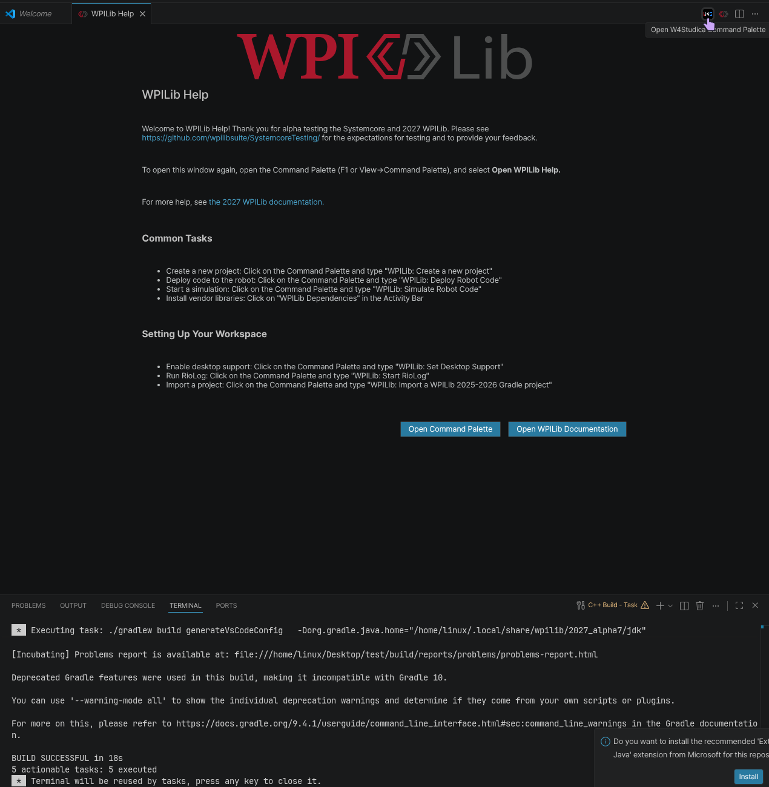

## Install the W4Studica extension

1. Open the [W4Studica VS Code Extension releases](https://github.com/W4Studica/W4Studica-VS-Code-Extension/releases) and download the latest `.vsix` file from the release **Assets**.

   

2. In WPILib VS Code, open the **Extensions** view, select **…**, and choose **Install from VSIX…**.

   

3. Select the `.vsix` file you downloaded and click **Install**.

   

Next, create a WPILib robot project below. Keep the project open when you choose the VMX deploy target; W4Studica project commands are available only while a project is open. Use WPILib-installed VS Code so the WPILib tools and extensions are available.

## Create a C++ robot project

1. Open the Command Palette with **Ctrl+Shift+P** and run **WPILib: Create a new project**.

   
2. Set **Template** to **C++**.
3. Select **Command v2 Robot**.
4. Enter your team's assigned number in **Team Number**. Check that it matches your team before continuing.
5. Complete the remaining project fields and select **Create Project**.

   The generated project opens in WPILib VS Code. This captured project also shows a successful build.

   
6. With the generated project open, open the Command Palette and select **W4Studica: Change the deploy target to VMX (from SystemCore)**. The yellow outline and arrow in the screenshot mark the VMX target command.

   

## Optional: Update W4Studica library versions

With a project open, **W4Studica: Update W4Studica Version** downloads and pins the newest compatible W4Studica library versions for that project. This is a separate, optional maintenance command; it does not switch the deploy target.
