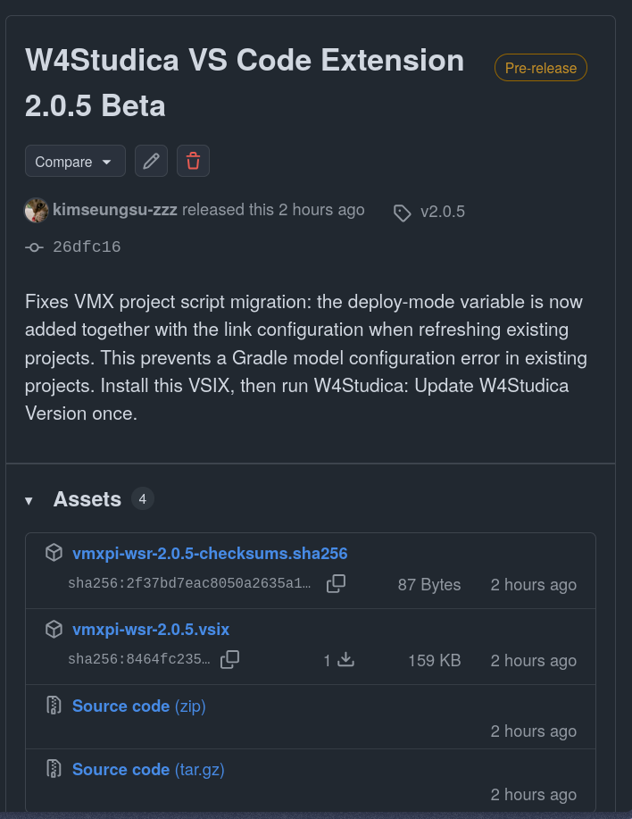
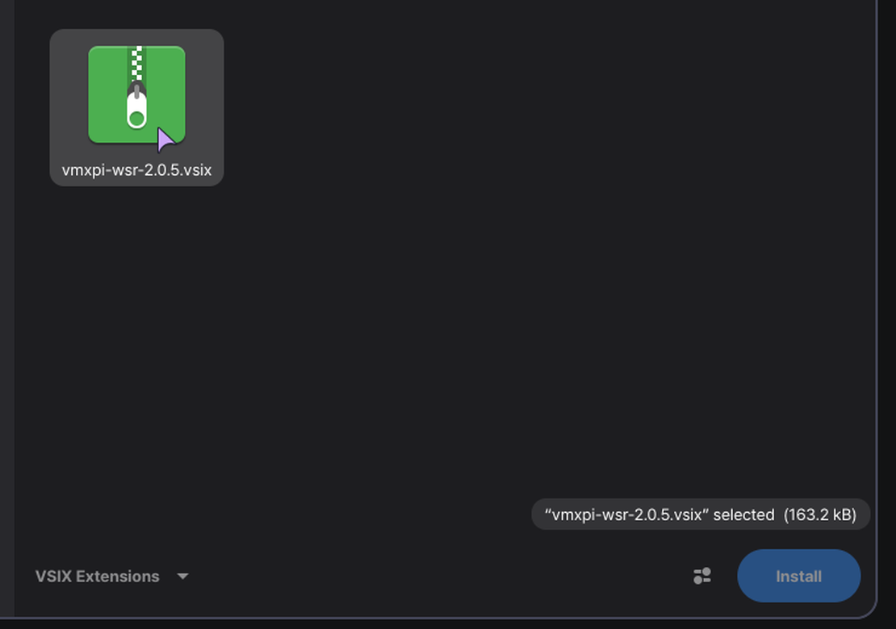
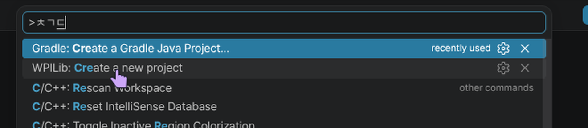

## W4Studica 확장 프로그램 설치

1. [W4Studica VS Code Extension 릴리스 페이지](https://github.com/W4Studica/W4Studica-VS-Code-Extension/releases)를 열고 최신 릴리스의 **Assets**에서 `.vsix` 파일을 다운로드합니다.

   

2. WPILib VS Code의 Activity Bar에서 **Extensions** 아이콘을 클릭합니다. 아래 캡처에서 마우스 포인터가 해당 아이콘을 가리킵니다.

   

3. Extensions 화면에서 **…**를 누른 다음 `Install from VSIX…`를 선택합니다.

   

4. 다운로드한 `.vsix` 파일을 선택하고 **Install**을 누릅니다.

   

이제 아래 순서대로 WPILib 로봇 프로젝트를 만드세요. VMX 배포 대상을 선택할 때 프로젝트가 열려 있어야 합니다. W4Studica 프로젝트 명령은 프로젝트가 열려 있을 때만 사용할 수 있습니다. WPILib 도구와 확장 프로그램이 설치된 WPILib VS Code를 사용하세요.

## C++ 로봇 프로젝트 만들기

1. **Ctrl+Shift+P**로 명령 팔레트를 열고 **WPILib: Create a new project**를 실행합니다.

   
2. **Template**에서 `C++`를 선택합니다.
3. 프로젝트 종류로 **Command v2 Robot**을 선택합니다.
4. **Team Number**에 팀에서 사용하는 번호를 입력합니다. 다음 단계로 넘어가기 전에 팀 번호가 정확한지 확인하세요.
5. 나머지 프로젝트 정보를 입력하고 **Create Project**를 선택합니다.

   프로젝트가 열리면 빌드를 실행해 성공하는지 확인합니다. 아래 캡처에 **BUILD SUCCESSFUL** 결과가 보입니다.

   
6. 프로젝트를 연 상태에서 편집기 도구 모음의 **W4Studica** 아이콘을 클릭해 W4Studica 명령 팔레트를 엽니다. 아래 캡처에서 포인터가 W4Studica 아이콘 위에 있고, 툴팁에 “Open W4Studica Command Palette”라고 표시됩니다.

   
7. **W4Studica: Change the deploy target to VMX (from SystemCore)**를 선택합니다. 아래 캡처에서 노란 테두리와 화살표가 VMX 대상 명령을 가리킵니다.

   

## 선택 사항: W4Studica 라이브러리 버전 업데이트

프로젝트가 열린 상태에서 **W4Studica: Update W4Studica Version**을 실행하면 해당 프로젝트에 사용할 수 있는 최신 W4Studica 라이브러리 버전을 내려받아 고정합니다. 이 명령은 별도의 선택적 유지 관리 기능이며, 배포 대상을 VMX로 바꾸지는 않습니다.

## 다음 단계

[Adding W4Studica Libraries](adding-w4studica-libraries.md)로 이동해 VMX-Pi 라이브러리 설정을 계속하세요.
